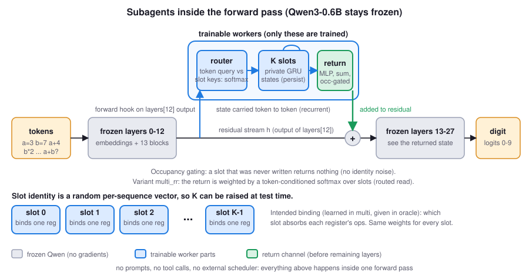
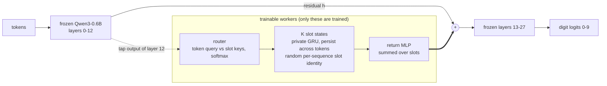
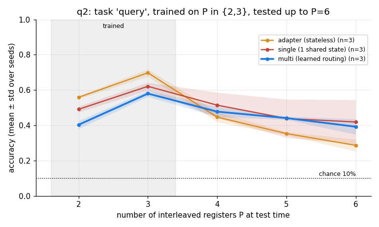

# qwenagent: subagents inside Qwen

**Persistent-state "subagents" living inside a frozen Qwen3-0.6B forward pass: private recurrent worker states, a learned slot router, and a return channel. No prompts, no tool calls, no external scheduler.**

<!-- HERO:BEGIN (generated) -->
_Hero animation lands as soon as the q3 traces are pulled into `traces/` and `viz/build_all.sh` is re-run._
<!-- HERO:END -->

## The 30-second version

Agent frameworks get "subagents" by calling the model again and again from the outside. Here the subagents are *inside* one forward pass. At layer 12 of a frozen Qwen3-0.6B we tap the residual stream and feed it to K small neural workers. Each worker owns a private recurrent (GRU) state that persists from token to token. A learned router decides, per token, which worker absorbs it. After each token, the workers' states are decoded by a small MLP and **added back into the residual stream before layers 13-27 run**, so the frozen Qwen reads the result like any other activation. Only the workers are trained (Qwen's weights never change).

We test this on **interleaved register programs**: P registers each get their own stream of arithmetic ops (mod 10), all shuffled together in one token stream, and the model must answer a query at the end. Solving it needs concurrent bookkeeping of several running values. The model is trained on a few registers and tested on more.

That a frozen LM can host trainable internal workers that learn to bind to subproblems and hand results back is the result. Which ingredient (persistence, private states, learned routing) does the work is what the ablation ladder below is designed to separate. See [What we know / what we do not yet](#what-we-know--what-we-do-not-yet) for where that stands, stated plainly.



<details><summary>Mermaid version</summary>


</details>

## How it works

Everything lives in [`worker.py`](worker.py); the hook is installed by [`train.py`](train.py).

- **Module.** `Workers(d_model, K, d_s)`. A forward hook on `lm.model.layers[12]` passes the hidden states through the workers and adds the result to the residual stream. All Qwen parameters are frozen.
- **Slot states.** K slots, each a `d_s`-wide GRU state, all sharing the same weights. A token's projection is written into a slot with a gate (router weight times a learned write gate); the slot updates by `GRUCell` and stays put otherwise. States persist across the whole sequence.
- **Router.** The token's query is matched against each slot's current state (key projection), softmax with a sharpening factor. Slot identity is a **random per-sequence initial state**, not a learned ID embedding, so the router must discover binding from content and **K can be raised at test time** (we run with `K = max(K, P)`). No test-time retraining.
- **Return channel.** `phi(LayerNorm(state_k))`, summed over slots, added to the residual at layer 12 *before* layers 13-27. The last linear of `phi` is zero-initialized, so training starts from exactly the frozen model.
- **Readout.** The answer is the argmax over Qwen's logits restricted to the ten digit tokens at the final position. Loss is cross-entropy on those ten.

## The task

[`task.py`](task.py) builds programs like `a=3 b=7 a+4 b*2 a-1 | a+b+c? =`. Each of P registers (letters a to p) gets an initial digit and a private stream of `+`, `-` or `*` ops mod 10, then all streams are interleaved at random. Task `subset` (the q3 task) asks for the sum mod 10 of three queried registers' final values, so no single register can be ignored. Chance is 10%. The generator also emits per-token ground-truth register ids, used only for the oracle mode and for visualization (never for the normal modes).

## The ablation ladder

All modes share the same plumbing (same hook, same return path), so each rung changes one thing. Parameter counts are matched to `multi` (`--match_params`) for `single` and `adapter`.

| mode | what it is | what comparing it to the next rung isolates |
|---|---|---|
| `none` | frozen Qwen, no workers | is the task solvable without any help |
| `adapter` | stateless per-token MLP, param-matched | `adapter` vs `none`: is extra capacity at layer 12 enough |
| `single` | ONE persistent state, width param-matched | `single` vs `adapter`: does persistence (memory across tokens) help |
| `uniform` | K private states, every token updates every slot equally, no routing | `uniform` vs `single`: does having K separate states help without any binding |
| `multi` | K private states, learned router | `multi` vs `uniform`: does learned routing of subproblems to workers help. **This is the "subagent" claim.** |
| `oracle` | K private states, router replaced by true register ids | `oracle` vs `multi`: how far is the learned router from perfect binding (upper bound) |

Intervention ablations at test time (run for every mode with workers): **zero** the return channel (must collapse to chance, proving the answer flows through the workers), **shuffle** returns across the batch (a worker's output is only useful for its own sequence), **drop** slot 0 (do the slots carry distinct information).

## Results

Accuracy is mean ± population std over seeds (n shown per row), 200 eval programs per test size and seed (`--n_eval` default in `train.py`; q2 JSONs predate that field), chance = 10%. Numbers below are generated from `results/*.json` by [`viz/make_tables.py`](viz/make_tables.py); nothing is typed by hand.

<!-- RESULTS:BEGIN (generated by viz/make_tables.py, do not edit) -->
Headline source: `q2` (the most recent experiment with results in `results/`). q3 results are not in the repo yet, so these are the older q2 numbers (task `query`, easier), clearly not the final claim. 

**q2**: task `query`, trained on P in {2,3}, 6000 steps, K=4, layer 12; accuracy in %, mean ± std (population std) over n seeds; chance = 10%.

| mode | n seeds | trainable params | P=2 | P=3 | P=4 | P=5 | P=6 |
|---|---|---|---|---|---|---|---|
| adapter | 3 | not recorded | 55.9 ± 0.9 | 69.8 ± 2.0 | 44.7 ± 2.8 | 35.3 ± 1.0 | 28.7 ± 3.3 |
| single | 3 | not recorded | 49.1 ± 1.7 | 62.1 ± 2.2 | 51.4 ± 7.2 | 43.9 ± 10.9 | 41.9 ± 12.5 |
| multi | 3 | not recorded | 40.3 ± 2.2 | 58.0 ± 1.7 | 47.8 ± 2.9 | 44.1 ± 1.0 | 39.2 ± 4.4 |

Intervention ablations at P2 (accuracy %, mean ± std):

| mode | intact | zero return | shuffle across batch | drop slot 0 |
|---|---|---|---|---|
| single | 49.1 ± 1.7 | 11.0 ± 0.0 | 12.3 ± 1.6 | 9.6 ± 1.9 |
| multi | 40.3 ± 2.2 | 11.0 ± 0.0 | 26.0 ± 7.1 | 26.9 ± 2.7 |
<!-- RESULTS:END -->

Raw per-seed numbers behind the rows above:

<!-- FACTS:BEGIN (generated) -->
- `q2`, P=6 (largest test size): adapter 28.7 ± 3.3 (per seed: 24, 30, 32); single 41.9 ± 12.5 (per seed: 26, 57, 43); multi 39.2 ± 4.4 (per seed: 39, 45, 34).
  - `single` with the return zeroed at P2: 11.0 ± 0.0 (intact 49.1 ± 1.7).
  - `multi` with the return zeroed at P2: 11.0 ± 0.0 (intact 40.3 ± 2.2).
<!-- FACTS:END -->

Figures (regenerated by `viz/build_all.sh`; per-experiment files `figures/<exp>_*.png`):

- Accuracy versus number of registers, the key plot: `figures/q3_accuracy_vs_registers.png` (and `figures/q2_accuracy_vs_registers.png` for the older, easier task)
- Learning curves, ablation bars and parameter budgets: `figures/<exp>_learning_curves.png`, `figures/<exp>_ablations.png`, `figures/<exp>_params.png`



_The figure above is the older q2 experiment (task `query`, train P in {2,3}); q3 figures are added by `viz/build_all.sh` once its results are in `results/`._

## What we know / what we do not yet

**Established by the data in `results/`:**
- Frozen Qwen3-0.6B with workers injected at layer 12 learns the register tasks well above 10% chance, and **zeroing the return channel drops every worker mode to chance** (see ablation table). The answer really does flow through the internal workers.
- In the older q2 experiment (task `query`), the persistent-state modes degrade more slowly than the stateless adapter as P grows beyond the trained sizes (see the per-seed line above): persistence helps generalization to more registers.

**Not established (yet):**
- **Private versus shared state is unproven.** In q2 the single shared state is not separable from `multi` with 3 seeds; seed variance for `single` is large and one seed matches or beats `multi`. q2 had no `uniform` or `oracle` rung, so it cannot separate private states from routing.
- q3 (task `subset`, K=8, train P in {2,3,4}, test up to P=16, all six modes) is the experiment built to separate them: `uniform` vs `single` (private states), `multi` vs `uniform` (routing), `oracle` vs `multi` (router quality). Until the q3 rows appear in the table above, treat the subagent-specific claim (routing matters) as a hypothesis.
- Absolute accuracy is far from solved at larger P; the interesting quantity is the *shape* of accuracy versus P and the gaps between rungs.
- One model (Qwen3-0.6B), one injection layer, one task family, few seeds. No claim beyond that.

History: q1 (single seed, easy `query` task) was a smoke test; q2 (3 seeds) gave the persistence result above. Both remain in `results/` for the record.

## Reproduce

Training needs a CUDA GPU and `torch`, `transformers`; the visualization side needs only `numpy`, `matplotlib`, `pillow` and runs on a laptop.

```bash
# one run: mode in none|adapter|single|uniform|multi|oracle, seed 0 also saves a ckpt and a trace
./run_q3.sh multi 0          # writes results/q3_multi_s0.json, logs/q3_multi_s0.log, traces/q3_multi_s0.json

# everything visual: figures, tables (results/TABLE.md + README blocks), GIFs from traces/q3_*_s0.json
./viz/build_all.sh
```

Defaults for q3: `--task subset --train_P 2,3,4 --test_P 2,4,6,8,12,16 --K 8 --d_s 64 --layer 12 --steps 4000`. Run seeds 0,1,2 per mode for the error bars.

## Repo layout

```
worker.py        workers module (router, slot GRU states, return MLP, param matching)
task.py          interleaved register-program generator (+ ground-truth register ids)
train.py         training, evaluation, intervention ablations, trace export
run_q3.sh        q3 launcher (mode, seed)
results/         one JSON per run (args, params, log, final accuracies); TABLE.md generated
logs/            training logs
traces/          per-token router assignments for seed 0 (feed the GIFs)
figures/         generated PNGs and GIFs
viz/             make_figures.py, make_tables.py, make_gifs.py, arch.svg, build_all.sh
viz/fixtures/    SYNTHETIC trace used only to test the GIF renderer; never in figures
```
