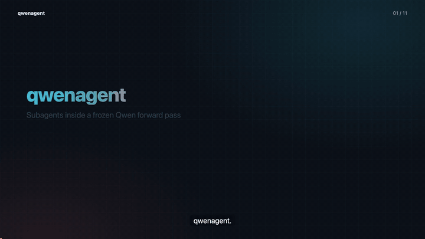
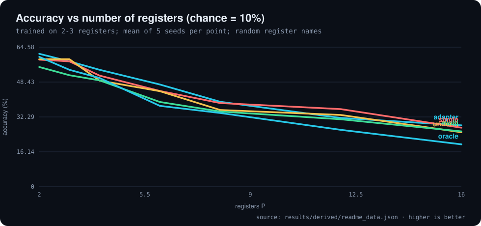
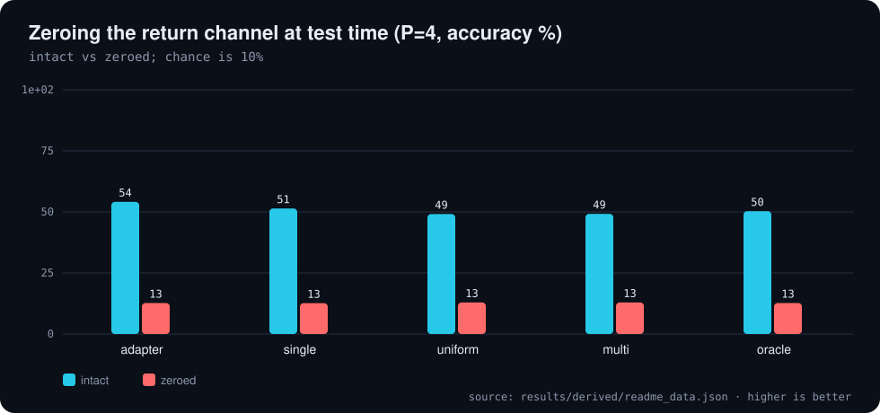
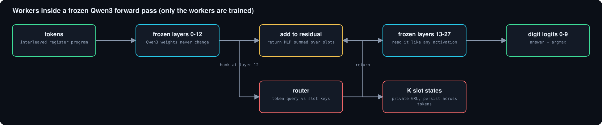
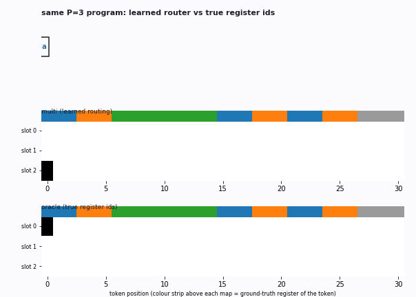
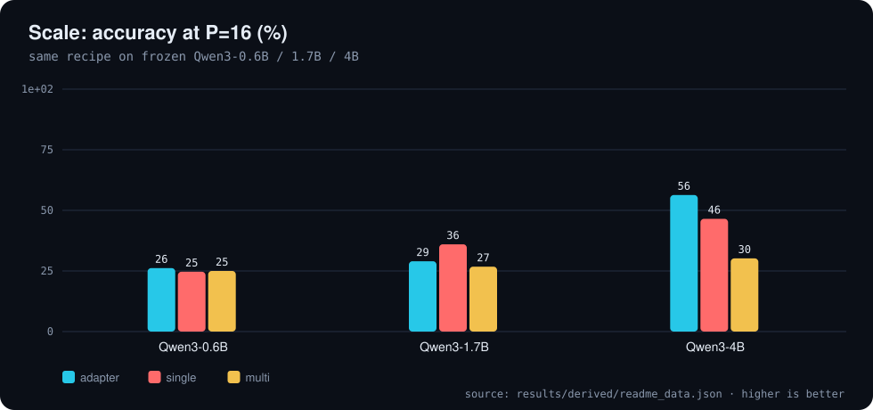

<div align="center">



# 🧠 qwenagent

**Subagent-like stateful workers inside a frozen Qwen3 forward pass: what works, and what does not**

    

[🎬 Video](#video) · [📊 Results](#results) · [🧩 How it works](#how-it-works) · [🔬 Follow-ups](#follow-ups) · [⚠️ Limitations](#caveats) · [🔁 Reproduce](#reproduce) · [🗺️ Repo map](#repo-map)

</div>

---

**Explainer video (voice-over and subtitles): the idea, the task, the results, and the honest null result**

[](video/qwenagent_explainer.mp4)

<a id="video"></a>
Agent frameworks get "subagents" by calling a model again and again from the outside. Here the subagent-like modules live **inside one forward pass**:
at the output of layer 12 of a frozen Qwen3-0.6B, K small neural workers each own a private recurrent (GRU) state, a learned router decides per token
which worker absorbs it, and the workers' states are decoded and **added back into the residual stream before layers 13-27**. Only the workers are trained.

The test is **interleaved register programs**: P registers each get a private stream of arithmetic ops (mod 10), shuffled into one token stream, and the model reports one register's final value.
Training uses 2-3 registers; testing goes to 16. Chance is 10%.

> **Headline.** Embedding trainable stateful modules in a frozen LM works (frozen Qwen is at 9.6%; zeroing the return channel sends every mode back to chance),
> but **private slots are not a win**: a stateless adapter and a single shared state do as well or better, and the slot version is less stable across seeds.

<a id="results"></a>

## 📊 Results

Query task, trained on P in {2,3}, 8000 steps, K=4 slots, injection at layer 12, random register names (q9 recipe, 5 seeds). All numbers are computed from `results/*.json` by `tools/readme_data.py`.

**Accuracy (%) by number of registers, mean ± std over 5 seeds (random register names, K=4, layer 12)**

| mode | seeds | P=2 | P=3 | P=4 | P=6 | P=8 | P=12 | P=16 |
| :--- | ---: | ---: | ---: | ---: | ---: | ---: | ---: | ---: |
| adapter | 5 | 61.5 ± 2.2 | 58.0 ± 1.3 | 54.1 ± 2.1 | 47.3 ± 1.6 | 39.3 ± 2.7 | 31.8 ± 5.1 | 28.4 ± 3.5 |
| single | 5 | 58.8 ± 1.7 | 58.0 ± 3.2 | 51.4 ± 2.6 | 44.3 ± 3.2 | 38.7 ± 4.7 | 35.9 ± 6.9 | 27.3 ± 4.2 |
| uniform | 5 | 59.0 ± 1.8 | 59.0 ± 1.9 | 49.1 ± 3.4 | 44.2 ± 2.7 | 35.5 ± 2.6 | 33.2 ± 3.2 | 25.2 ± 4.6 |
| **multi** | **5** | **55.4 ± 3.8** | **51.6 ± 4.6** | **49.2 ± 3.2** | **39.2 ± 7.0** | **34.8 ± 8.7** | **31.2 ± 11.7** | **25.6 ± 8.2** |
| oracle | 5 | 60.1 ± 2.0 | 54.1 ± 2.1 | 50.3 ± 1.9 | 37.4 ± 2.6 | 34.1 ± 4.3 | 26.3 ± 4.2 | 19.6 ± 3.3 |

<sub>Source: `results/derived/readme_data.json`</sub>

<p align="center"></p>

<p align="center"></p>

Frozen Qwen3-0.6B with no workers sits at chance (9.6% at P=2). Zeroing the return channel at P=4 returns every trained mode to about 12.9%: the answers flow through the injected modules.
The learned router reaches high purity against the true register ids (mean 88% at P=4), without an accuracy gain. Mean accuracy over P=2..16: adapter 45.8%, multi 41.0%, parameter-matched LoRA 39.4%.
The complete ablation ladder, probes, per-seed tables and run timeline are kept in [docs/RESEARCH_LEDGER.md](docs/RESEARCH_LEDGER.md).

<a id="how-it-works"></a>

## 🧩 How it works

Everything lives in [`worker.py`](worker.py); the hook is installed by [`train.py`](train.py).

- **Module.** A forward hook on `lm.model.layers[12]` passes hidden states through the workers and adds the result to the residual stream. All Qwen parameters are frozen.
- **Slot states.** K slots, each a `d_s`-wide GRU state with shared weights. A token is written into a slot with a gate (router weight times a learned write gate).
- **Router.** The token query is matched against each slot's state with a sharpened softmax. Slot identity is a random per-sequence initial state, so K can change at test time.
- **Return channel.** `phi(LayerNorm(state_k))`, summed (or mean over occupied slots with `--ret_norm`), added at layer 12 before layers 13-27; the last linear is zero-initialised so training starts from the frozen model.
- **Readout.** Argmax over the ten digit tokens at the final position; cross-entropy on those ten.

The task generator is [`task.py`](task.py), e.g. `a=6 b=0 c=1 c+6 c+9 a+2 b-2 | a? =`.

<p align="center"></p>

<p align="center"></p>

<details>
<summary>The ablation ladder</summary>

| mode | what it is |
|---|---|
| `none` | frozen Qwen, no workers |
| `adapter` | stateless per-token MLP at layer 12, parameter-matched |
| `single` | ONE persistent state, parameter-matched |
| `uniform` | K private states, every token updates every slot, no routing |
| `multi` | K private states, learned router (the "subagent" claim) |
| `oracle` | K private states, router replaced by the true register ids |

</details>

The animation shows one seed-0 checkpoint of the fixed-name run: router weight per token, one slot per row, learned router on top and the oracle (handed the true register ids) below.

<a id="follow-ups"></a>

## 🔬 Follow-ups

Checks of whether the private-slot result is an artefact (tables in `results/q10_notes.md` to `results/q13_notes.md`).

**Model scale (injection at about 43% depth): accuracy % at P=4 and P=16**

| base model | mode | seeds | P=4 | P=16 |
| :--- | :--- | ---: | ---: | ---: |
| Qwen3-0.6B | adapter | 3 | 54.3 | 26.2 |
| Qwen3-0.6B | single | 3 | 52.8 | 24.7 |
| Qwen3-0.6B | multi | 3 | 50.0 | 25.0 |
| Qwen3-1.7B | adapter | 2 | 57.8 | 29.0 |
| Qwen3-1.7B | single | 2 | 57.2 | 36.0 |
| Qwen3-1.7B | multi | 2 | 51.0 | 26.8 |
| Qwen3-4B | adapter | 3 | 71.5 | 56.3 |
| Qwen3-4B | single | 3 | 71.7 | 46.5 |
| Qwen3-4B | multi | 3 | 67.0 | 30.2 |

<sub>Source: `results/derived/readme_data.json`</sub>

<p align="center"></p>

- **Parameter-matched LoRA (5 seeds):** LoRA after the injection layer 39.4% mean accuracy, against adapter 45.8% and multi 41.0%. No best-tuned-LoRA claim is made.
- **Capacity (q11, up to 64 registers):** a single recurrent state is not capacity-starved, and `multi` does not beat equal-width `single`.
- **Realistic ledger task (q12):** frozen Qwen at chance, every trained mode at least 0.88 at P=2-3; no slot advantage at P=12.
- **Depth and scale (q13):** layers 4 and 12 work, 18 degrades, 24 is near chance; adapter at P=4 goes from 54% (0.6B) to 72% (4B), and `multi` falls further behind at 4B.

<a id="reproduce"></a>

## 🔁 Reproduce

Training needs a CUDA GPU with `torch` and `transformers`; the visualisation side needs only `numpy`, `matplotlib`, `pillow`.

```bash
./run_q9.sh multi 0        # or any mode: none|adapter|single|uniform|multi|oracle; seed 0..4
python tools/readme_data.py                              # results/*.json -> results/derived/readme_data.json
python3 ~/video-readme-maker/vrm.py all README.spec.yml  # README.md, assets/, video/
./viz/build_all.sh         # figures, GIFs and the docs/RESEARCH_LEDGER.md tables
```
Launchers `run_q*.sh`; Modal apps `modal_*.py`.

<a id="caveats"></a>

## ⚠️ Honest caveats

- **One task family, toy scale.** Interleaved register programs and a ledger variant; 2-5 seeds per cell; accuracy on 200 programs per size.
- **Private slots are not shown to help.** With 5 seeds the nominal edge seen at 2 seeds disappeared; the slot version is also the least stable across seeds.
- **No tuned-LoRA claim.** LoRA on layers 0-12 stayed at chance with the workers' untuned recipe; no learning-rate sweep was run.
- **Long operation chains per register** collapse every mode to chance; that, not register count, is the unsolved wall.
- **1.7B has 2 seeds per mode, 4B `none` has 1 seed.** Single runs on shared GPUs; no confidence intervals beyond seed std.

<a id="repo-map"></a>

## 🗺️ Repo map

| Path | What it is |
|---|---|
| `worker.py` | workers module: router, slot GRU states, occupancy gating, routed read, param matching |
| `task.py` | interleaved register-program generator |
| `train.py` | training, evaluation, intervention ablations, trace export |
| `eval_ckpt.py` | probes on saved checkpoints |
| `results/` | one JSON per run plus notes; results/derived is produced by tools/readme_data.py |
| `docs/RESEARCH_LEDGER.md` | full tables, probes and run timeline (previous README) |
| `tools/readme_data.py` | derives README and video numbers from results/ |
| `figures/` | PNG figures and router GIFs |
| `README.spec.yml` | spec for video-readme-maker (README, charts, video) |
| `video/` | explainer mp4, srt, poster, preview gif (generated) |

---

<div align="center"><sub>Generated with video-readme-maker from README.spec.yml and results/.</sub></div>
